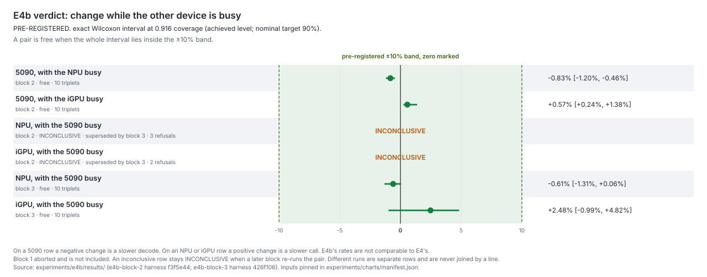
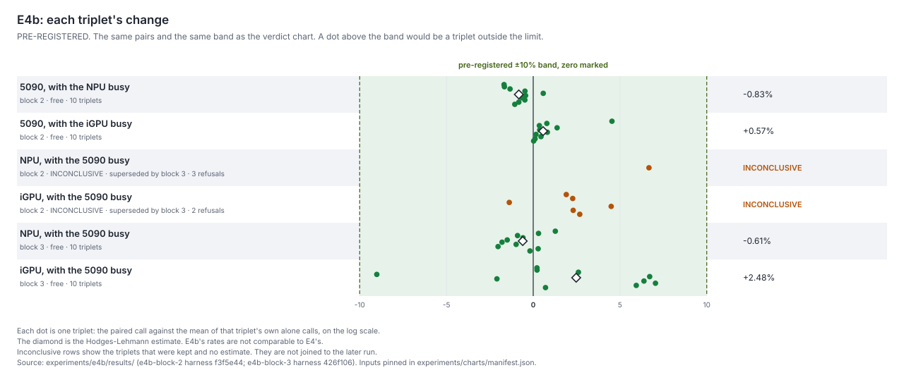
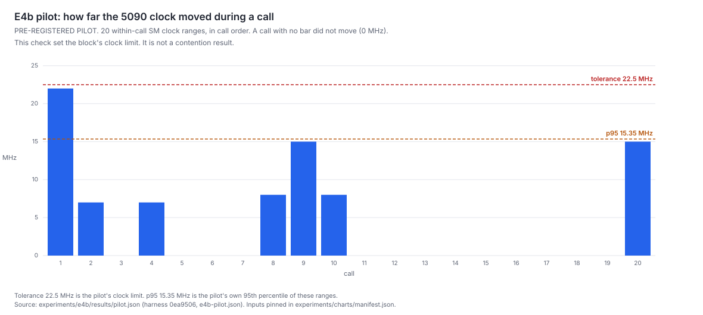
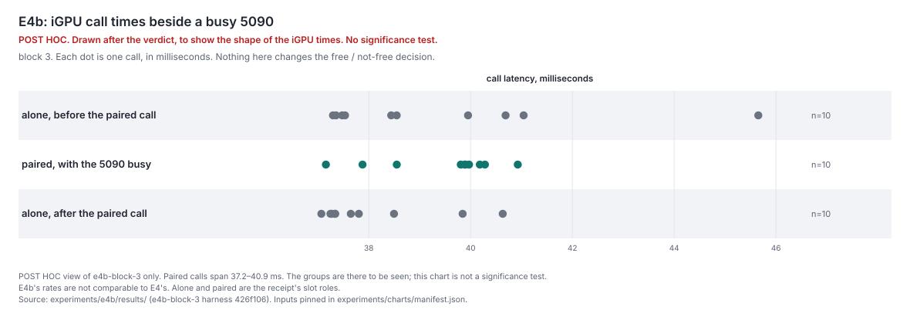

# E4b — do the 5090, the NPU and the iGPU slow each other down?

E4b asked whether the RTX 5090, the Intel NPU and the Intel iGPU keep their speed when another of them is busy at the same time. The entry is [E4b — the 5090, NPU and iGPU run free together](../../entries/2026/2026-10-12-e4b-block-2.md). The pre-registered rule is the interlock spec [`experiments/e4b/spec.yaml`](https://github.com/mcp-tool-shop-org/interlock/blob/426f10624c2f0da5d5e7777a7e6cce25a9a19fc6/experiments/e4b/spec.yaml) at the block 3 harness. Block 2 used the same ±0.10 band.

E4b's rates are not comparable to E4's. The prompt and the decision rule both changed.

## The rule, pre-registered

A pair is **free** when the whole interval sits inside ±0.10 on the log scale, about ±10%. The estimate is the Hodges-Lehmann estimate of the per-triplet log-ratio. The interval is the narrowest exact Wilcoxon interval whose nominal target is 90%. At ten triplets the exact interval's achieved level is 0.916, and that is the coverage the verdict chart names. Anything else, including a pair that did not finish, is inconclusive. A speed-up is not a free pass: an interval that lies entirely outside the band on either side is not free.

Block 1 aborted and is excluded. It is not in these results.

## The three runs

The pilot measured the 5090's clock during 20 calls and set the clock tolerance at 22.5 MHz. It is not a contention result. Its ranges and its p95 are in `results/pilot.json`.

Block 2 (`e4b-block-2`, harness f3f5e44) finished the two pairs that measure the 5090. Both are free. The two pairs that measure the NPU and the iGPU were refused (`companion_clock_range`: the 5090 companion had not reached a steady clock) and are **INCONCLUSIVE**. Those rows stay in the charts.

Block 3 (`e4b-block-3`, harness 426f106) re-ran only those two pairs after the harness waited for a steady companion. Both are free. The charts show block 3 as its own rows. They do not connect it to block 2.

| Pair | Run | Estimate | Interval | Verdict |
|---|---|---|---|---|
| 5090, with the NPU busy | block 2 | −0.83% | [−1.20, −0.46] | free |
| 5090, with the iGPU busy | block 2 | +0.57% | [+0.24, +1.38] | free |
| NPU, with the 5090 busy | block 2 | — | — | INCONCLUSIVE, superseded by block 3 |
| iGPU, with the 5090 busy | block 2 | — | — | INCONCLUSIVE, superseded by block 3 |
| NPU, with the 5090 busy | block 3 | −0.61% | [−1.31, +0.06] | free |
| iGPU, with the 5090 busy | block 3 | +2.48% | [−0.99, +4.82] | free |

The percentages are the log-ratio times 100, rounded to two decimals from `results/`. On a 5090 row, negative means a slower decode. On an NPU or iGPU row, positive means a slower call.

All four decided intervals sit inside the band. The entry's reading stands: the router can treat the three devices as independent lanes. The iGPU interval is the widest, and its upper end is still inside ±10%.

Promoted: not yet. The readouts-internal shelf waits until more interlock experiments are in.

## Charts

Built by `experiments/charts/make_charts.py` from `results/` only. The same files are copied to `site/public/charts/` for a later brief. This page is the caption.

### Verdict

Pre-registered. Each row is one pairing in one run. The dot is the typical change and the bar is the exact Wilcoxon interval at 0.916 coverage. The green band is the ±10% limit, and zero is marked. A pair is free when the whole bar sits inside the band. Two rows have no bar: block 2 could not decide the NPU or the iGPU, and those measurements are left as INCONCLUSIVE rather than dropped. Block 3's rows are the re-run. The speeds here are not comparable to E4.

### Per-triplet effects

Pre-registered. Each dot is one triplet, the paired call against that triplet's own alone calls. The diamond is the same typical change as in the verdict chart, and the band is the same limit. The refused pairs show only the triplets they kept. No line joins block 2 to block 3.

### Pilot clock stability

Pre-registered pilot. Each bar is how many megahertz the 5090's clock moved inside one call, for the 20 calls that set the later blocks' limit. The tolerance and the p95 are the pilot's own figures. Every bar is under the tolerance. This is a clock check, not a contention result.

### iGPU paired latency

Post hoc, drawn after the verdict to show the shape of the times. It is not a significance test and it does not change the free / not-free decision. The paired calls, the iGPU while the 5090 was busy, fall into two groups, about 38 ms and about 40 ms. The alone calls are drawn on their own rows. One alone-before call sits slower than the other alone calls, which is why the iGPU interval is the wide one. These times are not comparable to E4.

## What is here

| File | What it is |
|---|---|
| `extract.py` | Trims an interlock receipt down to the numbers the charts need. Re-run it when a new receipt lands, then `python experiments/charts/make_charts.py`. |
| `results/block-2.json`, `results/block-3.json` | The pairs' effects, estimates, intervals, achieved levels, verdicts, refusal events, and slot values and roles. |
| `results/pilot.json` | The pilot's clock ranges, p95 and tolerance. |

Each results file records the interlock repo, the harness commit, the source name and the sha256 of the source bytes. The trim drops argv, environment, server configuration and every machine path. The pilot document is not in the interlock tree; its file name and sha256 identify the bytes.
